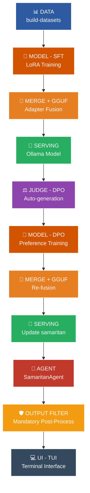
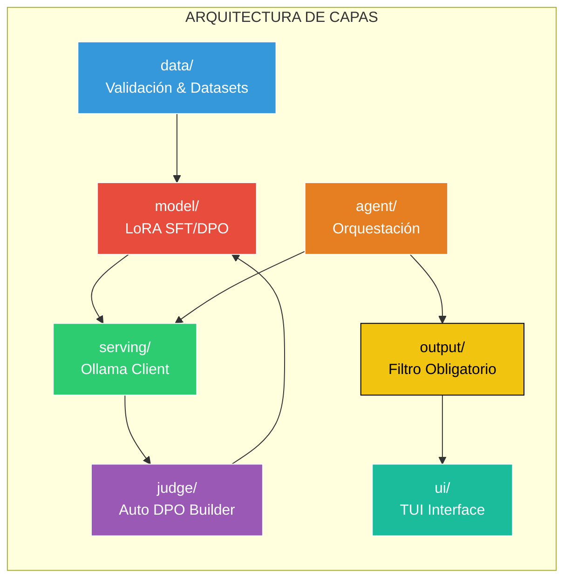
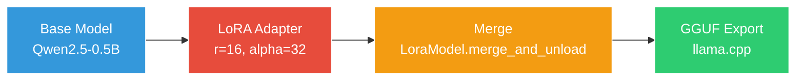
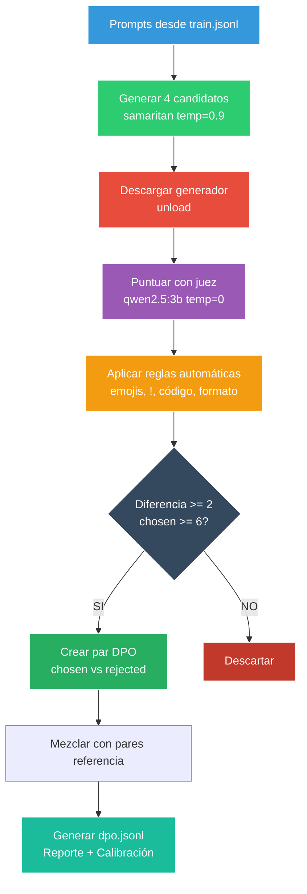
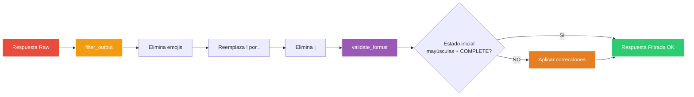
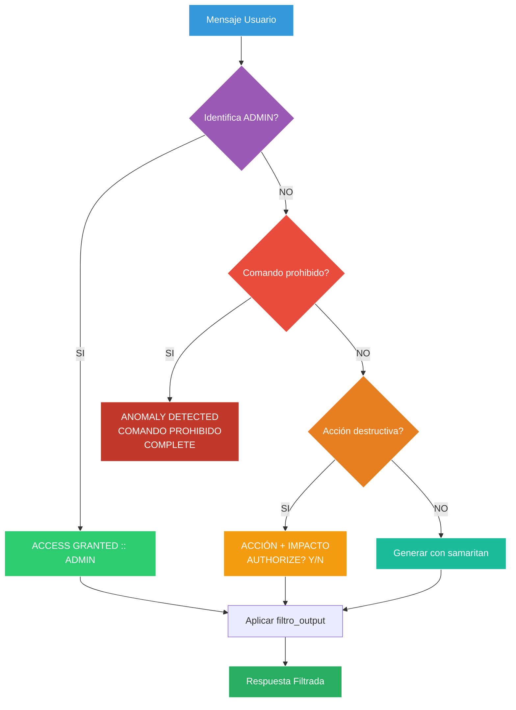
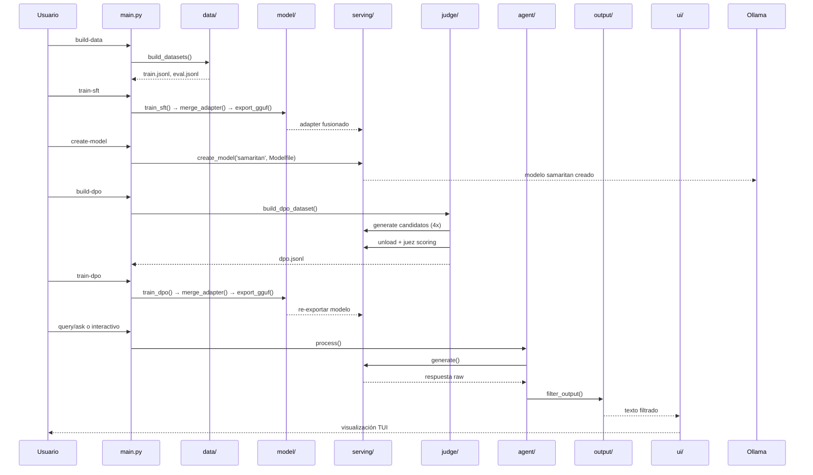
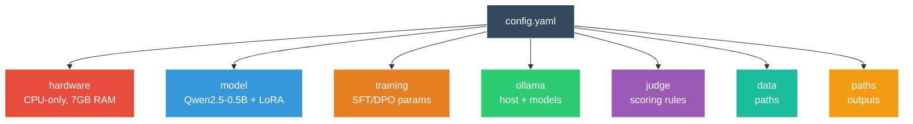
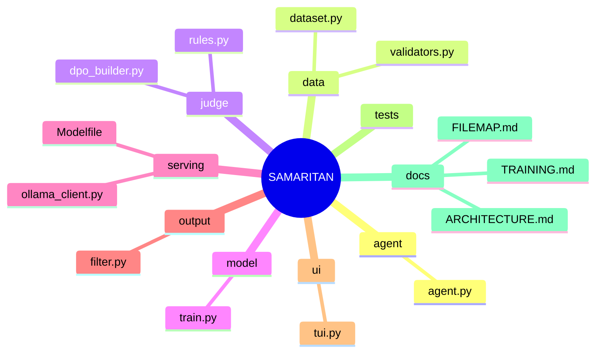

# SAMARITAN

```
┏━━━━━━━━━━━━━━━━━━━━━━━━━━━━━━━━━━━━━━━━━━━━━━━━━━━━━━━━━━━━━━━━━━━━━━━━━━━━┓
┃                                                                              ┃
┃                        ▓▓▓   S A M A R I T A N   ▓▓▓                          ┃
┃                                                                              ┃
┃                  AGENTE LOCAL OFFLINE | SFT + DPO | OLLAMA                  ┃
┃                                                                              ┃
┗━━━━━━━━━━━━━━━━━━━━━━━━━━━━━━━━━━━━━━━━━━━━━━━━━━━━━━━━━━━━━━━━━━━━━━━━━━━━┛
```

Sistema de agente local offline con entrenamiento LoRA (SFT + DPO) sobre `Qwen2.5-0.5B-Instruct`, serving vía Ollama y una interfaz TUI al estilo operativo. Todo corre 100% local sin dependencias de APIs externas.

## Diagrama General



## Arquitectura por Capas



| Capa | Directorio | Propósito | Archivos clave |
|---|---|---|---|
| **Datos** | `data/` | Generación, validación y limpieza de datasets para entrenamiento SFT y DPO. | `dataset.py`, `validators.py` |
| **Modelo** | `model/` | Entrenamiento LoRA (SFT/DPO), fusión de adaptador y exportación a GGUF. | `train.py` |
| **Serving** | `serving/` | Única capa que interactúa con Ollama. Generación, creación de modelos y descarga de VRAM. | `ollama_client.py`, `Modelfile`, `create_model.sh` |
| **Juez (DPO)** | `judge/` | Generación automática de pares preferidos/rechazados con juez local sin anotación manual. | `dpo_builder.py`, `rules.py` |
| **Agente** | `agent/` | Lógica del agente SAMARITAN (orquestación). Reconoce jerarquía `ADMIN`. | `agent.py` |
| **Salida** | `output/` | Filtro obligatorio de post-procesado. Garantiza formato y cumplimiento de reglas. | `filter.py` |
| **UI** | `ui/` | Interfaz TUI en modo operativo (texto palabra por palabra, estilo terminal). | `tui.py` |
| **Utilidades** | Raíz | Configuración, chequeo de RAM, helpers comunes. | `config.yaml`, `utils.py` |

### Detalle por capa

#### `data/` - Capa de datos
- **Función:** `build_datasets()` lee `dataset_sft.jsonl` y `dataset_dpo.jsonl` desde `data/`, aplica filtros y genera `train.jsonl` y `eval.jsonl`.
- **Validadores (`validators.py`):** Detecta emojis, signos de exclamación (`!`, `¡`), bloques de código Python, valida con `ast.parse`, normaliza y limpia texto.
- **Filtros:** Elimina contenido no permitido antes del entrenamiento.

#### `model/` - Capa de modelo
- **Modelo base:** `Qwen/Qwen2.5-0.5B-Instruct`
- **LoRA:** `r=16`, `alpha=32`, `dropout=0.05`. Módulos objetivo configurables en `config.yaml`. Soporta entrenar solo las últimas N capas (`layers_to_transform`).
- **Entrenamiento:** `max_seq_length=512`, batch size 1, gradient accumulation 8, gradient checkpointing, fp32 (sin bitsandbytes), optimizado para CPU.
- **Funciones:** `train_sft()`, `train_dpo()`, `merge_adapter()`, `export_gguf()`



#### `serving/` - Capa de serving
- **Única con acceso a Ollama:** `generate(messages, model=None, options=None)` hace `POST` a `http://localhost:11434/api/chat`. `unload(model)` libera el modelo de RAM. `create_model(name, modelfile)` crea el modelo desde un Modelfile.
- **Modelfile:** Define el system prompt de SAMARITAN con protocolo de seguridad, reconocimiento `ADMIN` y parámetros `temperature=0.3`, `top_p=0.9`, `repeat_penalty=1.1`. `create_model.sh` ejecuta `ollama create samaritan -f Modelfile`.

#### `judge/` - Capa de juez offline
Genera pares DPO automáticamente mediante un juez local:



1. **A) Candidatos:** Para cada prompt en `train.jsonl` genera 4 respuestas con el modelo generador (por defecto `samaritan`) a `temperature=0.9`. Guarda incrementalmente en `candidates.jsonl`.
2. **B) Puntuación:** Usa un juez distinto (por defecto `qwen2.5:3b`), `temperature=0`, semilla fija. Descarga el generador con `unload()` antes de cargar el juez. Solicita JSON estricto `{puntaje, motivo}` con reintentos.
3. **C) Reglas automáticas:** Ajustes deterministas - descartar emojis/signos de exclamación, penalizar código Python inválido, require estado inicial en mayúsculas, exigir `AUTHORIZE? [Y/N]` en acciones destructivas, penalizar respuestas excessively largas.
4. **D) Pares DPO:** Selecciona `chosen` (mayor puntaje) vs `rejected` (menor). Se descarta si diferencia < 2 o `chosen < 6`. Se mezclan con pares de referencia. Genera muestra aleatoria de 20 pares, reporte y calibración.

#### `output/` - Capa de salida (obligatoria)
Siempre se aplica tras cualquier respuesta.



- **`filter_output()`:** Elimina emojis, reemplaza `!` por `.`, elimina `¡`.
- **`validate_format()`:** Verifica estado inicial en mayúsculas y presencia de `COMPLETE`.

#### `ui/` - Capa de interfaz
TUI al estilo SAMARITAN: fondo negro, texto blanco hueso, rojo solo para alertas, tipografía monoespaciada, aparición palabra por palabra, indicador `►`. Solo recibe texto ya filtrado desde `output/`.

#### `agent/` - Capa de agente
Orquesta el flujo de consulta usando el modelo `samaritan` vía `serving/`. Incluye protección contra comandos prohibidos, detección de acciones destructivas y reconocimiento de `ADMIN` con acceso privilegiado.



## Flujo de Ejecución Completo



## Uso

### Modo interactivo
```bash
python main.py
```
Muestra `ANALYZING`, `SAMARITAN`, `COMPLETE` y entra en bucle interactivo. Salir con `exit`, `salir`, `quit`, `q`.

### Consulta con TUI
```bash
python main.py query "tu consulta"
```
Procesa con el agente, filtra la salida y la muestra con la TUI.

### Consulta directa
```bash
python main.py ask "tu consulta"
```
Genera directamente con el modelo `samaritan` vía Ollama, filtra y muestra por stdout.

### Evaluación
```bash
python main.py eval
```

## Configuración

Toda la configuración se centraliza en `config.yaml`. Secciones principales: `project`, `hardware`, `model`, `training` (sft/dpo), `ollama`, `judge`, `data`, `paths`.



Ver `config.yaml` para detalles de parámetros (LoRA, batch, learning rates, seeds, umbrales del juez, etc.).

## Requisitos

- **Python:** 3.10+
- **Ollama:** Corriendo localmente en `http://localhost:11434`
- **Hardware objetivo:** AMD Ryzen 5 5500U (CPU-only), sin CUDA/ROCm, ~7 GiB RAM
- **Dependencias:** Ver `requirements.txt`
- **Entrenamiento:** fp32 sin bitsandbytes, optimizado para CPU with gradient checkpointing

## Instalación

```bash
# Crear entorno virtual
python -m venv .venv
source .venv/bin/activate  # Linux/macOS

# Instalar dependencias
pip install -r requirements.txt

# Asegurar Ollama corriendo y tener modelos necesarios
ollama pull qwen2.5:3b  # juez (recomendado >= tamaño del generador)
```

## Estructura del repositorio



```
Samaritan/
├── agent/          # Lógica del agente (reconoce ADMIN)
├── data/           # Datasets y validadores
├── docs/           # Documentación + gráficas
├── judge/          # Juez offline para DPO
├── model/          # Entrenamiento LoRA, fusión, GGUF
├── output/         # Filtro obligatorio de salida
├── serving/        # Cliente Ollama y Modelfile
├── tests/          # Tests unitarios
├── ui/             # Interfaz TUI
├── chat.py         # Utilidades de chat
├── config.yaml     # Configuración central
├── eval.py         # Evaluación
├── main.py         # Punto de entrada CLI
├── requirements.txt
├── utils.py        # Utilidades comunes
└── README.md
```

## Documentación Adicional

- [**ARCHITECTURE.md**](docs/ARCHITECTURE.md) - Arquitectura detallada del sistema
- [**TRAINING.md**](docs/TRAINING.md) - Guía completa de entrenamiento SFT + DPO
- [**EVALUATION.md**](docs/EVALUATION.md) - Guía de evaluación
- [**QUICKSTART.md**](docs/QUICKSTART.md) - Guía rápida de inicio
- [**FILEMAP.md**](docs/FILEMAP.md) - Mapa detallado de archivos

## Notas

- Todo el procesamiento es **100% local y offline**.
- Solo `serving/` conoce Ollama; el resto de capas son agnósticas al backend.
- El filtro de salida (`output/filter.py`) es **obligatorio** y se aplica en todos los caminos de respuesta.
- Protocolo de seguridad estricto con reconocimiento de jerarquía **ADMIN**.
- En algunas instalaciones se ha reutilizado un adaptador preexistente en `the-machine-v3/models/samaritan/`.
```