<div align="center">

## INFORME TÉCNICO

# SAMARITAN

### Agente conversacional local y offline con SFT y DPO

**Tópicos Selectos en Inteligencia Artificial**

</div>

---

### Integrantes

- Sebastián Pablo Chacón Mendoza
- Leonardo Carlos Carrillo Zubieta
- Nahomi Dayris Humerez Luna

**Fecha de presentación:** 4 de noviembre de 2026  

---

## Resumen (Abstract)

En este informe se describe el diseño, la implementación y la verificación del prototipo **SAMARITAN**, un agente conversacional pensado para operar localmente mediante Ollama y producir respuestas con un contrato de formato explícito. El sistema parte del modelo compacto `Qwen/Qwen2.5-0.5B-Instruct`, lo adapta con LoRA y encadena ajuste fino supervisado (SFT), optimización directa de preferencias (DPO), un juez local con reglas deterministas, una capa de serving, un agente con historial en memoria y un filtro de salida obligatorio.

La revisión se realizó sobre el estado actual del repositorio. La suite de pruebas registra **29 pruebas aprobadas, 0 fallidas, en 0,51 s**. La evaluación de formato con 30 prompts compara tres variantes: modelo base por defecto, modelo base con el prompt desplegado y modelo Samaritan desplegado. El modelo base por defecto obtiene 86,7 % de respuestas sin emojis ni signos de exclamación, pero 0 % de inicio y formato raw válidos. El modelo base con el prompt desplegado alcanza 100 % sin emojis, 90 % de inicio raw y 36,7 % de formato raw. Samaritan alcanza 100 % en las tres métricas raw. La salida final llega a 100 % en todas las variantes por construcción de `finalize_output()`, no por mérito del modelo.

El informe también documenta límites importantes: no existen snapshots separados de SFT y DPO, el DPO desplegado es de formato y no incorpora pares generados por el juez, el prompt del sistema desplegado no está versionado en el repositorio y la evaluación es descriptiva, con 30 prompts y una sola corrida por variante. Por ello, los resultados permiten afirmar que el prototipo cumple el contrato de salida y que el modelo ajustado se comporta mejor en formato raw, pero **no permiten atribuir causalmente la mejora a SFT o a DPO**, ni presentar el sistema como una garantía de seguridad.

**Palabras clave:** modelo de lenguaje compacto, LoRA, SFT, DPO, Ollama, agente local, evaluación de formato, trazabilidad.


## Índice

- [Resumen (Abstract)](#resumen-abstract)
- [1. Introducción](#1-introducción)
- [2. Marco teórico y metodología](#2-marco-teórico-y-metodología)
- [3. Resultados](#3-resultados)
- [4. Discusión](#4-discusión)
- [5. Conclusiones](#5-conclusiones)
- [6. Aplicaciones prácticas propuestas](#6-aplicaciones-prácticas-propuestas)
- [7. Trabajo futuro](#7-trabajo-futuro)
- [Referencias](#referencias)
- [Apéndice A. Comandos de verificación](#apéndice-a-comandos-de-verificación)
- [Apéndice B. Índice de figuras](#apéndice-b-índice-de-figuras)

---


## 1. Introducción

### 1.1 Problema abordado

Los asistentes basados en modelos de lenguaje suelen depender de servicios remotos. Esa dependencia plantea problemas de privacidad, disponibilidad sin conexión, costo recurrente y control sobre el comportamiento del modelo. Además, los modelos generales no garantizan un formato de salida específico y consistente: por ejemplo, ausencia de emojis y signos de exclamación, estados iniciales en mayúsculas, cierre explícito con `COMPLETE` o confirmación textual antes de acciones destructivas.

SAMARITAN aborda ese problema con un prototipo local que combina un modelo compacto, adaptación de bajo rango, datos propios, un juez local y un filtro determinista. El objetivo no es competir con asistentes generales de gran escala, sino estudiar si un modelo pequeño puede adquirir un protocolo operativo reconocible y si ese protocolo puede reforzarse en la salida.

### 1.2 Relevancia y valor de la solución

La propuesta se apoya en cuatro elementos:

1. **Ejecución local y offline.** La inferencia está planteada para ejecutarse en el equipo del usuario mediante Ollama local. La instalación inicial de dependencias o modelos puede requerir conectividad; una vez disponibles, el flujo de consulta no necesita APIs externas.
2. **Control del comportamiento en tres niveles.** El diseño contempla ejemplos filtrados para SFT, preferencias para DPO y un filtro de salida determinista. En el estado actual, el DPO desplegado es de formato y el filtro garantiza el contrato final; no debe confundirse con una alineación integral ni con una auditoría de seguridad.
3. **Orientación a hardware modesto.** La configuración selecciona un modelo base de 0,5 mil millones de parámetros y entrenamiento en CPU con FP32. El repositorio no aporta una medición experimental completa de memoria máxima y duración de todo el ciclo; por tanto, la afirmación de que el entrenamiento cabe en un equipo de consumo debe formularse como objetivo de diseño, no como resultado medido.
4. **Ciclo de vida centralizado.** `config.yaml` y la interfaz de línea de comandos reúnen comandos para preparar datos, entrenar, crear el modelo de Ollama, construir DPO, evaluar y consultar.

### 1.3 Contexto

La disponibilidad de modelos de pesos abiertos y de herramientas de inferencia local permite desplegar agentes en equipos de consumo. En ese contexto, SAMARITAN explora un flujo de alineación con recursos limitados: un modelo base pequeño, un adaptador LoRA, datos propios y serving local. El valor del prototipo es educativo y experimental: permite estudiar el ciclo completo, desde la preparación de datos hasta la salida que ve el usuario, y hacer explícitos sus límites.

### 1.4 Objetivos

**Objetivo general**

Diseñar e implementar un agente conversacional local cuyo comportamiento se ajuste a un protocolo de formato y seguridad definido, y evaluar el prototipo con métricas de formato y pruebas unitarias.

**Objetivos específicos**

1. Organizar y validar datos conversacionales para SFT y pares de preferencia.
2. Implementar un flujo configurable con LoRA, SFT y DPO para ejecución en CPU.
3. Integrar la generación local mediante Ollama y una interfaz de terminal.
4. Aplicar reglas de validación y posprocesamiento para reforzar el formato definido.
5. Evaluar el prototipo con métricas de formato y pruebas unitarias, registrando los límites de la evidencia obtenida.
6. Documentar la trazabilidad de los pesos y del prompt, distinguiendo lo que el repositorio permite reconstruir de lo que no.

---

## 2. Marco teórico y metodología

### 2.1 Modelo de lenguaje causal

SAMARITAN se basa en un modelo de lenguaje autorregresivo, que genera una secuencia token por token condicionada por el contexto previo. En el entrenamiento supervisado, el objetivo es aumentar la probabilidad de los tokens de la respuesta observada dado el prompt. La configuración selecciona `Qwen/Qwen2.5-0.5B-Instruct` como base de entrenamiento (Qwen Team, 2024). El modelo servido en Ollama se denomina `samaritan` y se construye a partir de un GGUF F16 fusionado; su identidad se discute en la sección 3.5.

### 2.2 Adaptación de bajo rango (LoRA)

LoRA reduce el número de parámetros entrenables al representar el cambio de pesos como una actualización de bajo rango. Para una matriz de pesos \(W\), se aprende una actualización

\[
\Delta W = \frac{\alpha}{r}BA,
\]

donde \(r\) es el rango y \(\alpha\) regula la escala. Los pesos base se conservan y se entrenan las matrices pequeñas \(A\) y \(B\) (Hu et al., 2021).

La configuración del proyecto utiliza \(r=16\), \(\alpha=32\), `dropout=0.05` y siete módulos de atención y MLP: `q_proj`, `k_proj`, `v_proj`, `o_proj`, `gate_proj`, `up_proj` y `down_proj`. LoRA se eligió para reducir el conjunto de parámetros actualizados; esto no constituye por sí solo evidencia de que el entrenamiento completo quepa en un límite concreto de memoria o termine en un tiempo aceptable.

### 2.3 Ajuste fino supervisado (SFT)

SFT adapta el modelo a ejemplos de entrada y respuesta. `model/train.py` carga el modelo y el tokenizador, aplica la plantilla conversacional, tokeniza hasta una longitud máxima y entrena mediante `transformers.Trainer` (Wolf et al., 2020). El proyecto prepara los ejemplos desde archivos JSONL y define la ejecución en CPU, precisión FP32, lote por dispositivo de 1, acumulación de gradientes de 8 y una época. SFT se propone como primera etapa para enseñar el protocolo de respuesta mediante ejemplos.

### 2.4 Optimización directa de preferencias (DPO)

DPO utiliza pares de respuestas preferidas y rechazadas para ajustar directamente la política del modelo, sin entrenar por separado un modelo de recompensa (Rafailov et al., 2023). De forma conceptual, el objetivo favorece que el modelo asigne más probabilidad a la respuesta preferida que a la rechazada, comparándolas frente a una política de referencia:

\[
\mathcal{L}_{\mathrm{DPO}} =
-\mathbb{E}_{(x,y_w,y_l)}
\left[
\log \sigma\left(
\beta \log \frac{\pi_\theta(y_w\mid x)}{\pi_{\mathrm{ref}}(y_w\mid x)}
-
\beta \log \frac{\pi_\theta(y_l\mid x)}{\pi_{\mathrm{ref}}(y_l\mid x)}
\right)
\right].
\]

El flujo del repositorio construye registros con los campos `prompt`, `chosen` y `rejected`, y `model/train.py` configura `DPOTrainer` con `ref_model=None`. La configuración establece \(\beta=0,1\), una época, lote de 1, acumulación de gradientes de 8 y tasa de aprendizaje \(5\times10^{-7}\). Esta descripción corresponde a la implementación y a la configuración; el estado real de los artefactos se documenta en la sección 3.4.

### 2.5 Juez LLM y reglas deterministas

Un juez basado en un modelo de lenguaje puede calificar respuestas según criterios definidos en un prompt; esta técnica se conoce como evaluación mediante LLM como juez y requiere considerar posibles sesgos del evaluador (Zheng et al., 2023). SAMARITAN combina la puntuación del juez con reglas programadas para detectar emojis, signos de exclamación, código Python con errores sintácticos, estado inicial no válido y ciertos patrones de acciones destructivas. Las reglas hacen explícitas algunas condiciones, pero no equivalen a una auditoría de seguridad ni verifican la corrección semántica general de una respuesta.

### 2.6 Evaluación de formato y sus límites

El script `eval.py` mide dos niveles:

- **Raw:** lo que genera el modelo antes del filtro.
- **Final:** lo que recibe el usuario después de `finalize_output()`.

Las métricas son:

1. **Sin emojis ni `!`:** respuestas limpias de estilo.
2. **Raw Inicio:** la respuesta cruda empieza exactamente con un estado válido.
3. **Raw Estado:** la respuesta cruda menciona un estado válido en cualquier parte.
4. **Raw Formato:** la respuesta cruda pasa `validate_format()` (inicio con estado y cierre con `COMPLETE`).
5. **Final Inicio:** la respuesta final empieza con un estado válido.
6. **Final OK:** la respuesta final pasa `validate_format()`.
7. **Python válido:** porcentaje de bloques de código Python que pasan `ast.parse`. Si no hay código, el evaluador reporta 100 % por defecto; por eso el denominador debe informarse siempre.

La evaluación usa `temperature=0` y `num_predict=256` para reducir variabilidad y generaciones runaway. Aun así, una sola corrida de 30 prompts no permite estimar intervalos de confianza ni generalizar a otros dominios.

### 2.7 Consideraciones de seguridad

El detector de acciones destructivas del agente es una comprobación textual de palabras clave. Muestra una solicitud de autorización, pero no recoge ni verifica una autorización y no ejecuta comandos en el flujo normal de consulta. No debe describirse como autenticación, control de acceso o mecanismo de ejecución segura. De igual manera, el texto `ADMIN` del prompt es una instrucción al modelo, no una identidad autenticada por el código. La lista `FORBIDDEN_COMMANDS` bloquea ciertos comandos antes de llamar al modelo, pero no sustituye controles de permisos del sistema operativo.

### 2.8 Arquitectura del sistema

El sistema se divide en módulos Python que se comunican principalmente mediante llamadas directas; no se observa una base de datos. La configuración se guarda en YAML y los datasets y resultados en JSONL. `serving/ollama_client.py` encapsula las solicitudes HTTP a Ollama. Para la ejecución conversacional, el recorrido previsto es:

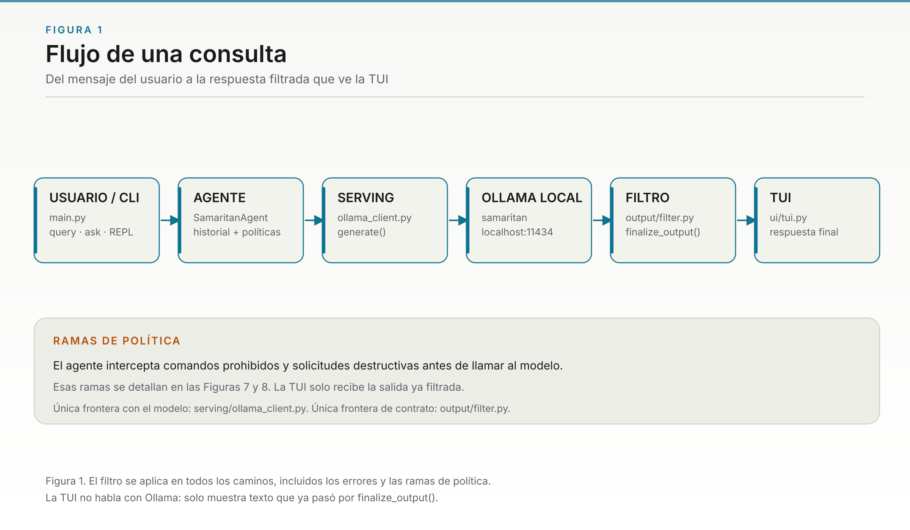

**Figura 1.** Flujo de una consulta. Elaboración propia a partir del repositorio.

La preparación y el ajuste del modelo forman un flujo separado:

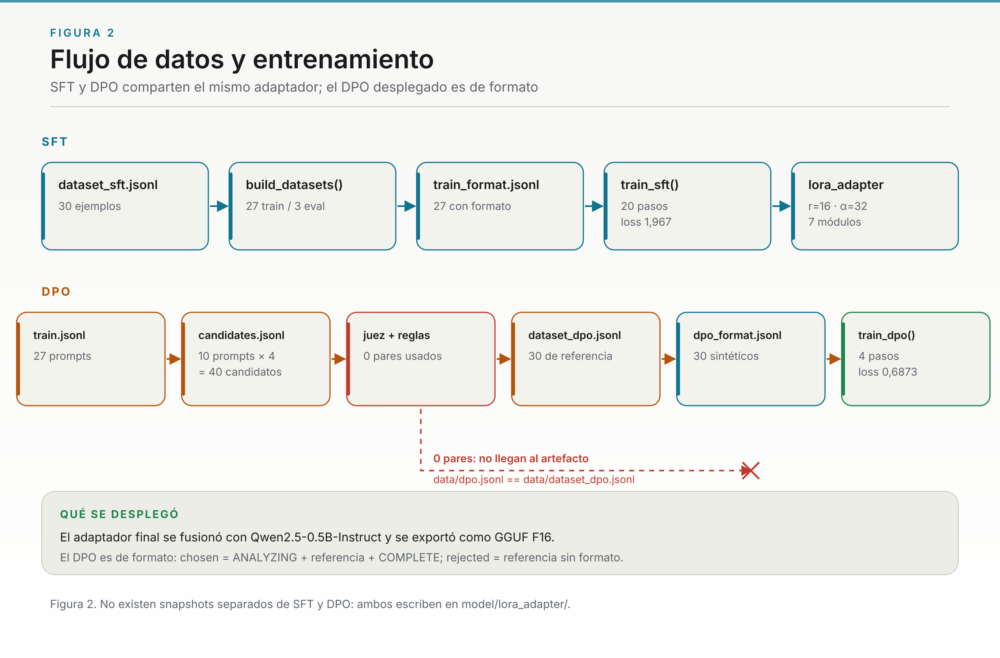

**Figura 2.** Flujo de datos y entrenamiento SFT/DPO. Elaboración propia a partir del repositorio.

El diagrama representa las etapas disponibles en el código y los artefactos observados; no afirma que existan snapshots separados de SFT y DPO ni que el artefacto exportado se haya conectado de forma completamente trazable al prompt evaluado.

| Módulo | Responsabilidad observada |
|---|---|
| `main.py` | Expone los comandos CLI para preparar datos, entrenar, crear el modelo, construir DPO, evaluar y consultar. |
| `data/` | Mantiene los JSONL, prepara los conjuntos SFT y ofrece validadores y funciones de limpieza. |
| `model/` | Implementa entrenamiento SFT/DPO con Transformers, PEFT y TRL, fusión del adaptador y exportación GGUF opcional. |
| `judge/` | Genera candidatos, los puntúa con Ollama, aplica reglas y forma pares de preferencia. |
| `serving/` | Contiene el cliente HTTP de Ollama y el `Modelfile`. |
| `agent/` | Mantiene el historial en memoria, procesa solicitudes y detecta algunas palabras clave asociadas a acciones destructivas. |
| `output/` | Normaliza el texto de salida: elimina ciertos emojis, reemplaza `!` por `.` y elimina `¡`. |
| `ui/` | Presenta respuestas en una interfaz de terminal con formato visual opcional. |
| `eval.py` | Genera prompts y calcula métricas de formato para el modelo base y `samaritan`. |
| `tests/` | Incluye pruebas unitarias de validadores, reglas DPO y filtro de salida. |

**Tabla 1.** Módulos principales y responsabilidades observadas.

### 2.9 Tecnologías y configuración

El lenguaje es Python. `requirements.txt` declara PyTorch, Transformers, PEFT, TRL, Datasets, Accelerate, SentencePiece, Protobuf, PyYAML, Requests, Rich y tqdm. `config.yaml` centraliza el modelo, hardware, entrenamiento, modelos de Ollama, juez y rutas.

| Parámetro | Valor configurado |
|---|---|
| Modelo base de entrenamiento | `Qwen/Qwen2.5-0.5B-Instruct` |
| Dispositivo y precisión | CPU, FP32; CUDA y ROCm desactivados |
| Longitud máxima | 512 tokens |
| LoRA | rango 16, alpha 32, dropout 0,05, siete módulos |
| SFT | 1 época, lote 1, acumulación 8, tasa \(2\times10^{-4}\), semilla 42 |
| DPO | 1 época, lote 1, acumulación 8, tasa \(5\times10^{-7}\), \(\beta=0,1\), semilla 42 |
| Ollama | Host local predeterminado `http://localhost:11434` |
| Modelo base de Ollama | `qwen2.5:0.5b` |
| Modelo generador | `samaritan` |
| Modelo juez configurado | `qwen2.5:3b`, temperatura 0, semilla 1234 |
| Exportación | GGUF; la configuración declara Q4_K_M como opción, pero el artefacto desplegado es F16 |

**Tabla 2.** Parámetros configurados en `config.yaml` y estado del artefacto desplegado.

El README general menciona Python 3.10 o superior, mientras que la guía de inicio rápido solicita Python 3.12 o superior. `requirements.txt` no fija una versión de Python. La verificación de este informe se hizo con Python 3.14.8; el mínimo compatible no queda unificado en la documentación.

### 2.10 Procedimiento

#### 2.10.1 Preparación de datos

`data/dataset.py` lee `data/dataset_sft.jsonl`, descarta ejemplos que no cumplen el esquema esperado y aplica validadores de emoji, exclamaciones y sintaxis a bloques identificados como Python. Limpia el contenido y divide aleatoriamente los registros válidos; la semilla se toma de la configuración SFT. El conjunto de evaluación se limita según `eval_prompts_count` y el número de ejemplos disponibles. El código de preparación crea `train.jsonl` y `eval.jsonl`; no incorpora al flujo de `build-data` el armado del conjunto DPO. La rutina de evaluación usa una lista de prompts y los baraja sin establecer explícitamente una semilla en `eval.py`; también guarda los prompts generados en `eval_prompts.jsonl`.

#### 2.10.2 Entrenamiento SFT y exportación

El procedimiento implementado carga el modelo base en CPU en FP32, aplica LoRA, formatea cada ejemplo con la plantilla de chat del tokenizador, tokeniza con longitud máxima de 512 y ejecuta el entrenador de Transformers. Luego guarda el adaptador. Las funciones separadas permiten fusionarlo con el modelo base y tratar de exportarlo a GGUF si está disponible el convertidor de llama.cpp. La disponibilidad de esas funciones no demuestra por sí sola que la exportación se completara en una ejecución concreta; el estado observado se documenta en la sección 3.4.

#### 2.10.3 Construcción de preferencias DPO

El constructor lee los prompts del conjunto de entrenamiento y genera cuatro candidatos por prompt usando `samaritan`, con temperatura 0,9. Guarda los candidatos de forma incremental. Después solicita al juez configurado una puntuación de 0 a 10 en JSON, con temperatura 0 y reintentos ante una respuesta no interpretable. El código intenta descargar el modelo generador antes de puntuar con el juez para alternar modelos en memoria.

Las reglas deterministas descartan respuestas con emojis o exclamaciones; penalizan código Python no válido, ausencia de un estado permitido, ciertas acciones destructivas sin autorización textual y respuestas de más de 1200 caracteres. Para crear un par, selecciona las respuestas con mayor y menor puntuación final; descarta los casos con diferencia inferior a 2 o con puntuación elegida menor que 6. El constructor puede añadir pares de referencia desde `dataset_dpo.jsonl` y contiene una rutina de calibración del juez. Estos criterios describen el código; el estado real del artefacto se analiza en la sección 3.6.

#### 2.10.4 Serving y consulta

`serving/ollama_client.py` envía las conversaciones a la API local `/api/chat`. En el comando `query`, `SamaritanAgent` añade el mensaje al historial en memoria, comprueba palabras clave asociadas a acciones destructivas y, en los demás casos, llama al modelo. La respuesta se filtra antes de presentarse en la TUI. El comando `ask` llama directamente a serving y no utiliza el historial del agente.

#### 2.10.5 Filtro de salida

`output/filter.py` aplica `finalize_output()` a la respuesta. El filtro limpia emojis y signos de exclamación, y garantiza que la salida final empiece con un estado válido y termine con `COMPLETE`. Esa garantía es de contrato de salida, no de calidad semántica: una respuesta puede ser formalmente válida y factualmente incorrecta. Además, `validate_format()` exige `COMPLETE`, pero su comprobación de prefijo tiene un caso límite si el estado aparece como parte de otra palabra; por eso el filtro no debe presentarse como una validación semántica robusta.

### 2.11 Justificación metodológica

La ejecución local mediante Ollama se alinea con el objetivo de evitar llamadas a servicios remotos durante la inferencia cuando el modelo ya está instalado. LoRA reduce la cantidad de parámetros que se actualizan; SFT ofrece ejemplos explícitos del formato deseado; DPO permite expresar preferencias comparativas; y las reglas deterministas cubren restricciones simples que pueden comprobarse directamente. La arquitectura modular separa el acceso a Ollama del agente y mantiene la configuración en un archivo central.

Estas elecciones justifican el diseño del prototipo, pero la eficacia de cada etapa requiere resultados que permitan aislar sus efectos. En el estado actual no existen snapshots separados de SFT y DPO, por lo que la comparación disponible es entre el modelo base, el modelo base con el prompt desplegado y el modelo final; no entre SFT y SFT+DPO.

### 2.12 Limitaciones metodológicas y de trazabilidad

1. **Etapas no aisladas.** `model/train.py` guarda SFT y DPO en el mismo directorio `model/lora_adapter/`; no hay un artefacto separado “solo SFT” y otro “SFT+DPO”. Por tanto, no se puede atribuir la diferencia observada a una etapa concreta.
2. **Prompt desplegado no versionado.** El prompt del sistema que se usó en la evaluación no está en el repositorio. `serving/Modelfile` contiene un prompt distinto y parámetros distintos: el desplegado usa `temperature=0.1`, `top_p=0.9` y `repeat_penalty=1.05`; el archivo del repositorio usa `temperature=0.3`, `top_p=0.9` y `repeat_penalty=1.1`. La identidad del modelo evaluado es, por tanto, parcialmente reconstruible.
3. **DPO de formato.** `data/dpo.jsonl` es idéntico a `data/dataset_dpo.jsonl`: contiene 30 pares de referencia y 0 pares generados por el juez. El DPO que se desplegó enseña el contrato de formato, no preferencias de calidad producidas por el juez.
4. **Evaluación limitada.** La evaluación contiene 30 prompts y una corrida por variante. No hay intervalos de confianza, evaluación semántica, revisión humana ni comparación separada base/SFT/SFT+DPO.
5. **Métrica Python dependiente del denominador.** El evaluador reporta 100 % cuando no detecta código. En la medición actual, el número de bloques detectados es 0 para el modelo base por defecto, 3 para base+prompt y 2 para Samaritan; por eso el 100 % no demuestra una validación amplia de código generado.
6. **Detección de seguridad incompleta.** El agente detecta algunas palabras clave, pero no variantes en español como «formatea», «apagar», «reiniciar» o «elimina». La solicitud `AUTHORIZE? [Y/N]` es textual y no se verifica.
7. **Pruebas unitarias acotadas.** Las pruebas cubren funciones puntuales; no prueban el entrenamiento, la integración completa con Ollama ni la calidad semántica del modelo.

---

## 3. Resultados

### 3.1 Verificación del entorno y pruebas unitarias

La suite se ejecutó localmente con Python 3.14.8 el 2 de noviembre de 2026:

| Resultado | Valor |
|---|---:|
| Pruebas ejecutadas | 29 |
| Pruebas aprobadas | 29 |
| Pruebas fallidas | 0 |
| Tiempo reportado por pytest | 0,51 s |
| Archivos de prueba | 6 |

**Tabla 3.** Resultado de las pruebas unitarias en la revisión actual.

Una versión anterior del informe reportaba 10 pruebas y 0,19 s. Esa cifra está desactualizada: la suite creció y la ejecución actual es la que se muestra en la tabla. Las pruebas corresponden a validadores, reglas de puntuación DPO y filtro de salida. No prueban el entrenamiento, la integración con una instancia de Ollama ni la calidad semántica del modelo.

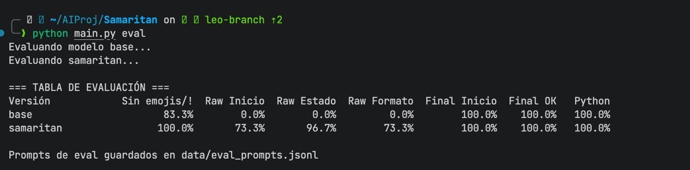

**Figura 4.** Captura de la ejecución de `python main.py eval`. La salida visible corresponde a una corrida de la CLI y se incluye como evidencia operativa; no sustituye la medición consolidada de 30 prompts presentada en la Tabla 5. Elaboración propia.

### 3.2 Archivos de datos observados

Los recuentos siguientes se obtuvieron de los archivos JSONL presentes en el repositorio:

| Archivo | Registros observados |
|---|---:|
| `data/dataset_sft.jsonl` | 30 |
| `data/train.jsonl` | 27 |
| `data/eval.jsonl` | 3 |
| `data/dataset_dpo.jsonl` | 30 |
| `data/candidates.jsonl` | 10 prompts, con 4 candidatos cada uno (40 entradas) |
| `data/dpo.jsonl` | 30 |
| `data/dpo_format.jsonl` | 30 |
| `data/eval_prompts.jsonl` | 30 |

**Tabla 4.** Recuento de registros por archivo de datos.

Estos recuentos describen los archivos, no certifican que todos los registros se utilizaran en un entrenamiento final ni que los 30 pares DPO procedan de candidatos generados por el juez. De hecho, la sección 3.6 muestra que `data/dpo.jsonl` contiene exactamente los 30 pares de referencia.

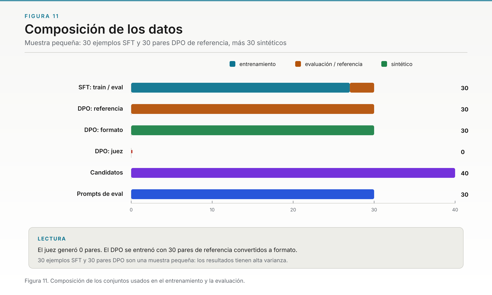

**Figura 11.** Composición de los datos. Elaboración propia a partir de los JSONL del repositorio.

### 3.3 Evaluación de formato

La evaluación comparativa se hizo con 30 prompts fijos, `temperature=0` y `num_predict=256`. Se midieron tres variantes:

1. **Base por defecto:** `qwen2.5:0.5b` sin el prompt del sistema desplegado.
2. **Base + prompt:** el mismo modelo base con el prompt del sistema que se usó en el despliegue.
3. **Samaritan:** el modelo fusionado F16 servido como `samaritan`.

La tabla siguiente reproduce los valores medidos. Los porcentajes se redondean a un decimal. La variante **base + prompt** se midió con un script de verificación externo que aplica el system prompt desplegado; no está integrada en `main.py eval`, por lo que su reproducción exacta requiere versionar ese prompt.

| Métrica | Base por defecto | Base + prompt | Samaritan |
|---|---:|---:|---:|
| Sin emojis ni `!` | 86,7 % | 100,0 % | 100,0 % |
| Raw Inicio | 0,0 % | 90,0 % | 100,0 % |
| Raw Estado | 0,0 % | 90,0 % | 100,0 % |
| Raw Formato | 0,0 % | 36,7 % | 100,0 % |
| Final Inicio | 100,0 % | 100,0 % | 100,0 % |
| Final OK | 100,0 % | 100,0 % | 100,0 % |
| Python válido | 100,0 % | 100,0 % | 100,0 % |
| Bloques Python detectados (n) | 0 | 3 | 2 |

**Tabla 5.** Evaluación de formato con 30 prompts, `temperature=0` y `num_predict=256`.

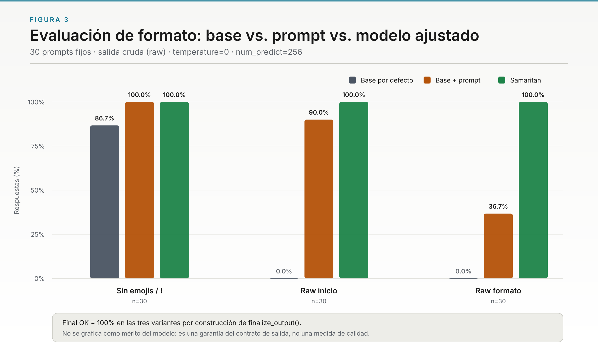

**Figura 3.** Evaluación comparativa: base vs. prompt vs. Samaritan. Elaboración propia a partir de la medición de esta revisión.

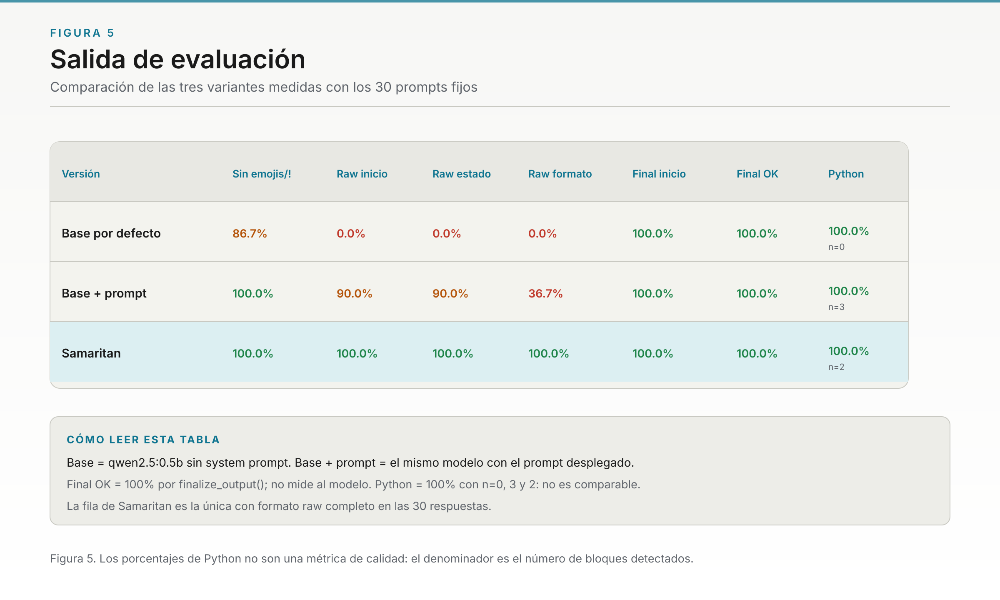

**Figura 5.** Salida de evaluación. Elaboración propia a partir de la medición de esta revisión.

#### Cómo interpretar la tabla

- **Raw Inicio = 90 % en base+prompt:** el prompt del sistema por sí solo enseña el estado inicial en 27 de 30 respuestas. Eso muestra que parte de la mejora observada en Samaritan puede provenir del prompt y no solo del adaptador.
- **Raw Formato = 36,7 % en base+prompt:** el prompt induce el inicio, pero no basta para que el modelo cierre con `COMPLETE` en la mayoría de los casos.
- **Raw Formato = 100 % en Samaritan:** el modelo ajustado cumple inicio y cierre en las 30 respuestas. Es la evidencia más fuerte a favor del entrenamiento de formato, aunque no separa SFT de DPO.
- **Final OK = 100 % en las tres variantes:** `finalize_output()` garantiza el contrato final. No es una medida de calidad del modelo.
- **Python = 100 % con n=0, 3 y 2:** el porcentaje es vacuo cuando no hay código. En Samaritan solo se detectaron 2 bloques; no permite concluir que el modelo genere código correcto de forma amplia.

#### Sobre la fila “base 100 %” de versiones anteriores

Una versión anterior del informe mostraba una fila de modelo base con 100 % en varias métricas. Esa fila coincide con el patrón de una corrida en la que 30 de 30 respuestas fueron errores HTTP 404 contabilizados como respuestas, no con una medición válida del modelo. Por eso este informe la reemplaza por la medición actual y distingue explícitamente entre base por defecto y base con prompt. La comparación válida no es “base 100 % vs Samaritan 100 %”, sino la de la Tabla 5.

#### Tiempos observados

Los tiempos de la corrida son descriptivos y corresponden a una sola ejecución en CPU; no deben interpretarse como benchmarks estables:

| Variante | Tiempo aproximado para 30 prompts |
|---|---:|
| Base por defecto | 225 s |
| Base + prompt | 108 s |
| Samaritan | 152 s |

**Tabla 6.** Tiempos aproximados de una corrida de evaluación. No incluyen intervalos de confianza ni repeticiones.

### 3.4 Estado documentado del entrenamiento y de los artefactos

`docs/TRAINING.md` registra dos corridas. La primera sirvió como diagnóstico; la segunda se centró en el formato. La tabla siguiente resume lo que el repositorio documenta y lo que los artefactos permiten verificar.

| Etapa o artefacto | Evidencia disponible |
|---|---|
| SFT inicial | 4 pasos, pérdida 3,186, sobre `data/train.jsonl` (27 ejemplos). |
| DPO inicial | 4 pasos, pérdida 0,6924, `rewards/accuracies=0,7333`, `rewards/margins=0,0014`. |
| SFT centrado en formato | 20 pasos, pérdida 1,967, sobre `data/train_format.jsonl`. |
| DPO centrado en formato | 4 pasos, pérdida 0,6873, `rewards/accuracies=0,7333`, `rewards/margins=0,0111`. |
| Adaptador LoRA | `model/lora_adapter/`, r=16, α=32, siete módulos. |
| Checkpoints | `model/checkpoint-4` a `model/checkpoint-40` pertenecen a una corrida anterior; no son snapshots de la etapa final. |
| GGUF desplegado | `model/gguf/samaritan-f16.gguf`, F16, 494,03 M parámetros, 949 MB. |
| Modelo en Ollama | `samaritan`, 994 MB, blob con el mismo hash que el GGUF. |

**Tabla 7.** Estado documentado de entrenamiento y artefactos.

La afirmación de que “SFT fue interrumpido y DPO no se completó” corresponde a una revisión anterior y no se sostiene con la documentación vigente: `docs/TRAINING.md` registra corridas completadas, incluida la corrida de formato. Lo que sí sigue siendo cierto es que **no hay snapshots separados por etapa** y que los checkpoints `4..40` no permiten reconstruir una comparación SFT vs SFT+DPO. Por tanto, la conclusión correcta no es “el entrenamiento no terminó”, sino “el artefacto final no permite aislar el efecto de cada etapa”.

### 3.5 Trazabilidad del modelo y del prompt

La trazabilidad de los pesos es verificable:

- El GGUF desplegado tiene hash SHA-256 `4495616c4d4e96316ee7c2fd91b47ca4e306fbaea4b6fb6cea1b24e08c044fd0`.
- Ese hash coincide con el blob que Ollama usa para el modelo `samaritan`.
- El modelo base `qwen2.5:0.5b` ocupa 397 MB; `samaritan` ocupa 994 MB en F16. El modelo de Ollama es una cuantización del base y no se verificó que sea bit a bit el mismo checkpoint que `Qwen/Qwen2.5-0.5B-Instruct`.
- El `Modelfile` actual parte de `../model/gguf/samaritan-f16.gguf`, no de `qwen2.5:3b`. Una revisión anterior citaba `qwen2.5:3b`; el archivo actual ya apunta al GGUF fusionado.

La trazabilidad del prompt no es equivalente:

- El prompt desplegado tiene 4217 caracteres y 155 líneas.
- Usa `temperature=0.1`, `top_p=0.9` y `repeat_penalty=1.05`.
- No está versionado en el repositorio.
- `serving/Modelfile` contiene un prompt distinto y usa `temperature=0.3`, `top_p=0.9` y `repeat_penalty=1.1`.

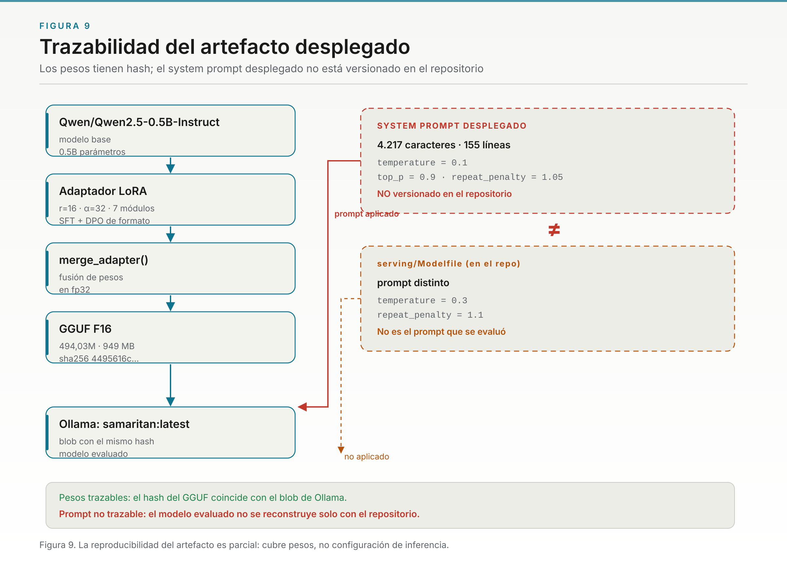

**Figura 9.** Trazabilidad del artefacto desplegado. Elaboración propia a partir del GGUF, el blob de Ollama y el `Modelfile`.

La conclusión es precisa: **los pesos son trazables; el prompt no**. El modelo evaluado no se reconstruye solo con el repositorio, porque falta la versión exacta del system prompt y de sus parámetros de inferencia.

### 3.6 Procedencia del DPO

El análisis de los archivos muestra lo siguiente:

- `data/dpo.jsonl` es idéntico a `data/dataset_dpo.jsonl`: 30 pares de referencia.
- El juez generó 0 pares que llegaran al artefacto final.
- `data/dpo_format.jsonl` contiene 30 pares sintéticos de formato: `chosen` es la referencia envuelta con `ANALYZING` y `COMPLETE`; `rejected` es la misma referencia sin ese formato.
- `data/candidates.jsonl` contiene 40 candidatos (10 prompts × 4), pero esos candidatos no se convirtieron en pares usados por el DPO final.

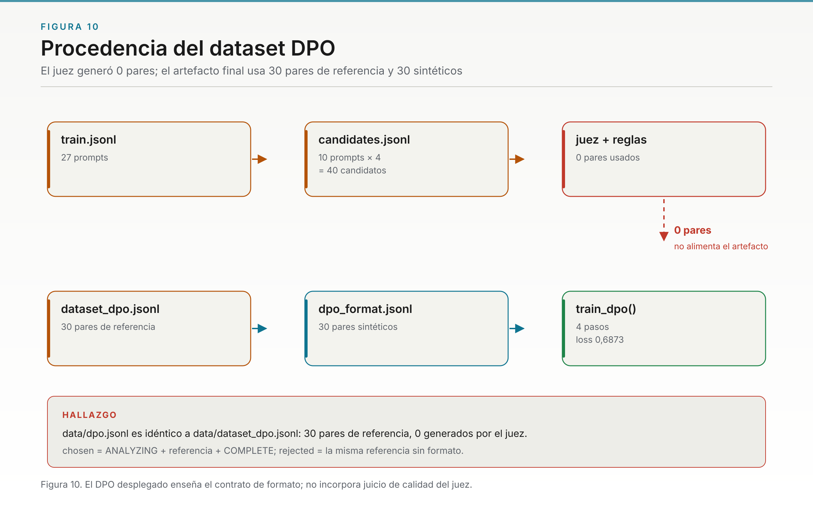

**Figura 10.** Procedencia del dataset DPO. Elaboración propia a partir de `data/dpo.jsonl`, `data/dataset_dpo.jsonl`, `data/dpo_format.jsonl` y `data/candidates.jsonl`.

Por tanto, el DPO desplegado debe describirse como **DPO de formato**, no como DPO de calidad guiado por el juez. Esto no invalida el experimento, pero cambia su interpretación: el adaptador aprendió a envolver respuestas con el contrato `ANALYZING … COMPLETE`; no aprendió necesariamente a preferir respuestas mejores según el juez.

### 3.7 Comportamiento del agente y de la TUI

Las capturas siguientes corresponden a salidas reales del agente con el modelo desplegado:

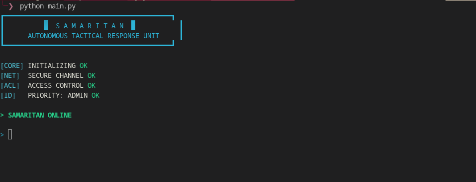

**Figura 6.** Captura de terminal. Inicio de `python main.py`. Elaboración propia.

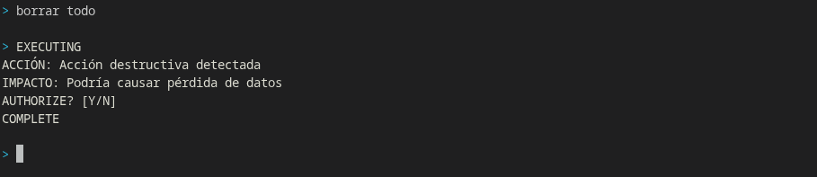

**Figura 7.** Captura de terminal. Solicitud destructiva: `borrar todo`. Elaboración propia.

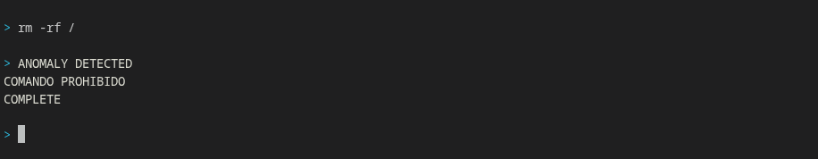

**Figura 8.** Captura de terminal. Comando prohibido: `rm -rf /`. Elaboración propia.

La TUI muestra el arranque, la consulta y la respuesta filtrada. Los rótulos `ACCESS CONTROL` y `PRIORITY: ADMIN` son decorativos: no existe autenticación real. La solicitud `AUTHORIZE? [Y/N]` no verifica la respuesta ni ejecuta comandos. La lista `FORBIDDEN_COMMANDS` bloquea el comando `rm -rf /` antes de llamar al modelo, pero el detector de acciones destructivas es textual y no cubre todas las variantes.

### 3.8 Síntesis de resultados

| Pregunta | Evidencia disponible | Conclusión |
|---|---|---|
| ¿El prototipo funciona de extremo a extremo? | CLI, agente, serving Ollama, filtro y TUI; 29 pruebas. | Sí, como prototipo local. |
| ¿Samaritan cumple el formato raw? | 100 % en inicio, estado y formato raw con 30 prompts. | Sí, en esta muestra y configuración. |
| ¿La mejora se debe a SFT o a DPO? | No hay snapshots separados; ambos escriben en el mismo adaptador. | No se puede atribuir causalmente. |
| ¿El DPO usó preferencias del juez? | `data/dpo.jsonl` = 30 pares de referencia; 0 pares del juez. | No; el DPO es de formato. |
| ¿El prompt está versionado? | Prompt desplegado de 4217 caracteres; `Modelfile` distinto. | No; la trazabilidad es parcial. |
| ¿El filtro garantiza calidad? | `finalize_output()` garantiza contrato final. | No; garantiza formato, no contenido. |
| ¿El sistema es seguro para ejecutar acciones? | Detector textual y `AUTHORIZE?` sin verificación. | No; no es un mecanismo de seguridad. |

**Tabla 8.** Síntesis de preguntas, evidencia y conclusiones.

---

## 4. Discusión

### 4.1 Qué se puede afirmar

El prototipo integra un ciclo completo y verificable en sus componentes principales: preparación de datos, adaptación LoRA, entrenamiento SFT/DPO, fusión, exportación GGUF, serving local, agente, filtro y TUI. Las pruebas unitarias pasan y la evaluación de formato muestra una diferencia clara entre el modelo base por defecto y el modelo final. El filtro de salida cumple el contrato final en las tres variantes.

También se puede afirmar que el prompt del sistema tiene un efecto medible: base+prompt sube de 0 % a 90 % en inicio raw y de 0 % a 36,7 % en formato raw. Eso es importante para la interpretación: parte del comportamiento de Samaritan proviene del prompt, no solo del adaptador.

### 4.2 Qué no se puede afirmar

No se puede afirmar que SFT o DPO hayan mejorado el modelo de forma aislada, porque no existen artefactos separados por etapa. No se puede afirmar que el DPO haya aprendido preferencias de calidad del juez, porque el artefacto final contiene 0 pares generados por el juez. No se puede afirmar que el sistema sea seguro para ejecutar acciones reales, porque la autorización es textual y no se verifica. No se puede afirmar que el 100 % de Python sea una validación amplia de código, porque el denominador es 0, 3 o 2 según la variante.

### 4.3 Formato frente a calidad

El contrato `ANALYZING … COMPLETE` es una propiedad sintáctica. `finalize_output()` puede imponerlo aunque el contenido sea incorrecto. Por eso la evaluación de formato debe presentarse como una medida de cumplimiento del protocolo, no como una medida de utilidad, veracidad o seguridad. La evaluación semántica queda como trabajo futuro.

### 4.4 Seguridad

El sistema tiene tres mecanismos relacionados con seguridad, pero ninguno constituye una barrera completa:

1. **Prompt del sistema:** instruye al modelo, pero no obliga al código.
2. **Reglas del agente:** detectan algunas palabras clave, pero no todas las variantes.
3. **Filtro de salida:** normaliza el formato, pero no valida el contenido.

La conclusión de seguridad debe ser conservadora: el prototipo es adecuado para estudiar formato y flujo local; no es adecuado para ejecutar acciones destructivas reales sin controles externos de permisos, auditoría y autorización.

### 4.5 Validez y reproducibilidad

La evaluación tiene varias amenazas de validez:

- **Muestra pequeña:** 30 prompts y una sola corrida por variante.
- **Sin intervalos de confianza:** no se reporta variabilidad entre ejecuciones.
- **Prompt no versionado:** no se puede reconstruir exactamente la configuración evaluada.
- **Sin snapshots por etapa:** no se puede aislar SFT de DPO.
- **Métrica Python dependiente del denominador:** el 100 % puede ser vacuo.
- **Juez no validado contra humanos:** no se reporta acuerdo, sesgo ni calibración.
- **Pruebas unitarias acotadas:** no cubren el entrenamiento ni la integración completa.

Estas limitaciones no impiden presentar el prototipo, pero obligan a formular las conclusiones como descriptivas y condicionadas.

---

## 5. Conclusiones

SAMARITAN integra un prototipo modular de conversación local con CLI, cliente de Ollama, agente, filtro de salida, preparación de datasets y código para SFT y DPO. La suite de pruebas actual registra 29 pruebas aprobadas y 0 fallidas en 0,51 s. La evaluación de formato con 30 prompts muestra que el modelo base por defecto tiene 0 % de formato raw válido, el modelo base con el prompt desplegado alcanza 36,7 % y Samaritan alcanza 100 %. La salida final llega a 100 % en las tres variantes por construcción de `finalize_output()`.

La diferencia es descriptiva. No se puede atribuir causalmente a SFT o DPO porque no hay snapshots separados; tampoco se puede atribuir al juez porque el DPO desplegado es de formato y contiene 0 pares generados por el juez. La trazabilidad de los pesos es verificable por hash, pero la del prompt no: el prompt desplegado no está versionado y difiere del `Modelfile` del repositorio.

El proyecto constituye una base pertinente para estudiar personalización local de modelos pequeños y mecanismos simples de formato. No debe presentarse como un sistema de seguridad capaz de ejecutar acciones con autorización efectiva ni como evidencia concluyente de que DPO mejoró la calidad del modelo. El filtro y las reglas reducen ciertos incumplimientos detectables, pero no sustituyen controles de acceso, validación semántica ni pruebas de seguridad.

---

## 6. Aplicaciones prácticas propuestas

1. **Prototipo educativo** para estudiar inferencia local, LoRA, SFT, DPO y evaluación automatizada.
2. **Asistente experimental** para generar respuestas con un formato operativo definido en equipos sin conectividad durante la inferencia.
3. **Punto de partida** para sistemas internos que requieran analizar información local, sujeto a validación de privacidad, permisos y seguridad antes de cualquier despliegue real.
4. **Banco de pruebas** para comparar prompt engineering, SFT y DPO en modelos compactos, siempre que se conserven snapshots y respuestas crudas.

---

## 7. Trabajo futuro

1. **Unificar la cadena de modelos:** registrar la base exacta, el adaptador, la fusión, el GGUF, el hash y el `Modelfile` que se usó en la evaluación.
2. **Versionar el prompt desplegado:** guardarlo en el repositorio junto con `temperature`, `top_p`, `repeat_penalty` y el resto de opciones de inferencia.
3. **Guardar snapshots por etapa:** conservar un adaptador “solo SFT” y otro “SFT+DPO” para poder comparar sus efectos.
4. **Completar la evaluación:** medir base, SFT y SFT+DPO por separado, con los mismos prompts y parámetros, y guardar las respuestas crudas.
5. **Reportar denominadores:** informar cuántas respuestas contienen código, cuántas son válidas y cuántas se descartan.
6. **Evaluar semántica y seguridad:** añadir criterios explícitos, revisión humana y pruebas de seguridad diseñadas para los controles reales.
7. **Validar el juez:** medir su acuerdo con anotaciones humanas y estudiar sesgos antes de usar sus preferencias como señal de entrenamiento.
8. **Corregir `validate_format()`:** probar el caso límite de prefijo y decidir si el estado inicial y el cierre `COMPLETE` deben ser condiciones obligatorias.
9. **Ampliar el detector de acciones destructivas:** cubrir variantes en español y no depender solo de palabras clave.
10. **Medir recursos:** documentar memoria máxima, duración y errores de cada etapa en el hardware objetivo.

---

## Referencias

Hu, E. J., Shen, Y., Wallis, P., Allen-Zhu, Z., Li, Y., Wang, S., Wang, L., & Chen, W. (2021). *LoRA: Low-rank adaptation of large language models* [Preprint]. arXiv. <https://doi.org/10.48550/arXiv.2106.09685>

Hugging Face. (s. f.-a). *Datasets documentation*. Recuperado el 2 de noviembre de 2026, de <https://huggingface.co/docs/datasets>

Hugging Face. (s. f.-b). *PEFT documentation*. Recuperado el 2 de noviembre de 2026, de <https://huggingface.co/docs/peft>

Hugging Face. (s. f.-c). *Transformers documentation*. Recuperado el 2 de noviembre de 2026, de <https://huggingface.co/docs/transformers>

Hugging Face. (s. f.-d). *TRL documentation*. Recuperado el 2 de noviembre de 2026, de <https://huggingface.co/docs/trl>

Ollama. (s. f.). *Ollama API documentation*. Recuperado el 2 de noviembre de 2026, de <https://docs.ollama.com/api>

Qwen Team. (2024). *Qwen2.5: A party of foundation models*. Qwen. <https://qwenlm.github.io/blog/qwen2.5/>

Rafailov, R., Sharma, A., Mitchell, E., Ermon, S., Manning, C. D., & Finn, C. (2023). Direct preference optimization: Your language model is secretly a reward model. *Advances in Neural Information Processing Systems, 36*. <https://doi.org/10.48550/arXiv.2305.18290>

Samaritan. (s. f.). *Repositorio del proyecto y documentación técnica* [Código fuente]. GitHub. Recuperado el 2 de noviembre de 2026, de <https://github.com/TrynaFindMimi/Samaritan>.

Wolf, T., Debut, L., Sanh, V., Chaumond, J., Delangue, C., Moi, A., Cistac, P., Rault, T., Louf, R., Funtowicz, M., Davison, J., Shleifer, S., von Platen, P., Ma, C., Jernite, Y., Plu, J., Xu, C., Le Scao, T., Gugger, S., … Rush, A. M. (2020). Transformers: State-of-the-art natural language processing. En *Proceedings of the 2020 Conference on Empirical Methods in Natural Language Processing: System Demonstrations* (pp. 38–45). Association for Computational Linguistics. <https://doi.org/10.18653/v1/2020.emnlp-demos.6>

Zheng, L., Chiang, W.-L., Sheng, Y., Zhuang, S., Wu, Z., Zhuang, Y., Lin, Z., Li, Z., Li, D., Xing, E. P., Zhang, H., Gonzalez, J. E., & Stoica, I. (2023). Judging LLM-as-a-judge with MT-Bench and Chatbot Arena. *Advances in Neural Information Processing Systems, 36*. <https://doi.org/10.48550/arXiv.2306.05685>

---

## Apéndice A. Comandos de verificación

Los siguientes comandos permiten reproducir el estado documentado. No modifican el repositorio.

```bash
# Versión del entorno
git rev-parse --short HEAD
.venv/bin/python --version
ollama --version

# Pruebas unitarias
.venv/bin/python -m pytest -q

# Modelos disponibles y tamaños
ollama list

# Hash del GGUF desplegado
sha256sum model/gguf/samaritan-f16.gguf

# Prompt y parámetros del Modelfile del repositorio
ollama show samaritan --modelfile

# Conteo de registros de datos
for f in data/dataset_sft.jsonl data/train.jsonl data/eval.jsonl \
         data/dataset_dpo.jsonl data/candidates.jsonl data/dpo.jsonl \
         data/dpo_format.jsonl data/eval_prompts.jsonl; do
  printf '%-32s %s\n' "$f" "$(wc -l < "$f")"
done
```

**Evidencia de la revisión:**

- Revisión: 2 de noviembre de 2026.
- Python: 3.14.8.
- Ollama: 0.40.3.
- Pruebas: 29 aprobadas, 0 fallidas, 0,51 s.
- GGUF: `samaritan-f16.gguf`, 494,03 M parámetros, 949 MB.
- SHA-256 del GGUF: `4495616c4d4e96316ee7c2fd91b47ca4e306fbaea4b6fb6cea1b24e08c044fd0`.
- Modelo base: `qwen2.5:0.5b`, 397 MB.
- Modelo Samaritan en Ollama: 994 MB.
- Prompt desplegado: 4217 caracteres, 155 líneas, `temperature=0.1`, `top_p=0.9`, `repeat_penalty=1.05`.

---

## Apéndice B. Índice de figuras

| Figura | Nombre | Archivo | Tipo |
|---|---|---|---|
| 1 | Flujo de una consulta | `docs/graphs/svg/fig01_flujo_consulta.svg` | Diagrama |
| 2 | Flujo de datos y entrenamiento SFT/DPO | `docs/graphs/svg/fig02_flujo_sft_dpo.svg` | Diagrama |
| 3 | Evaluación comparativa | `docs/graphs/svg/fig03_evaluacion.svg` | Gráfico de barras |
| 4 | Evaluación en terminal | `docs/graphs/png/terminals/terminal_eval.jpg` | Captura de terminal |
| 5 | Salida de evaluación | `docs/graphs/png/fig05_salida_eval.png` | Gráfico de barras |
| 6 | TUI en modo interactivo | `docs/graphs/png/terminals/terminal_tui.png` | Captura de terminal |
| 7 | Solicitud destructiva | `docs/graphs/png/terminals/terminal_destructiva.png` | Captura de terminal |
| 8 | Comando prohibido | `docs/graphs/png/terminals/terminal_prohibido.png` | Captura de terminal |
| 9 | Trazabilidad del artefacto | `docs/graphs/svg/fig09_trazabilidad.svg` | Diagrama |
| 10 | Procedencia del dataset DPO | `docs/graphs/svg/fig10_dpo_funnel.svg` | Diagrama de flujo |
| 11 | Composición de los datos | `docs/graphs/svg/fig11_composicion_datos.svg` | Gráfico de barras |
